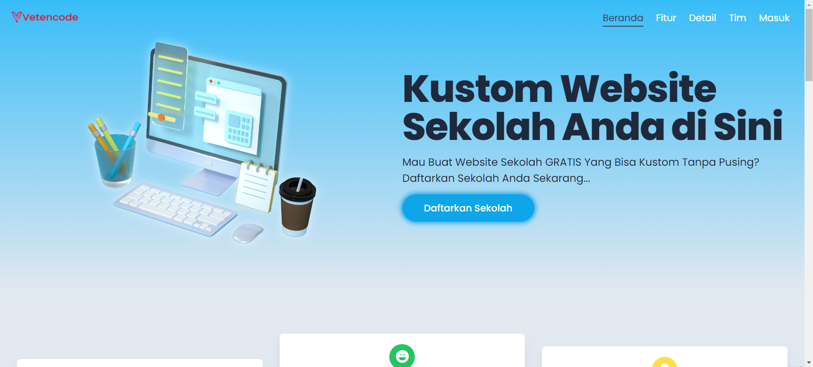
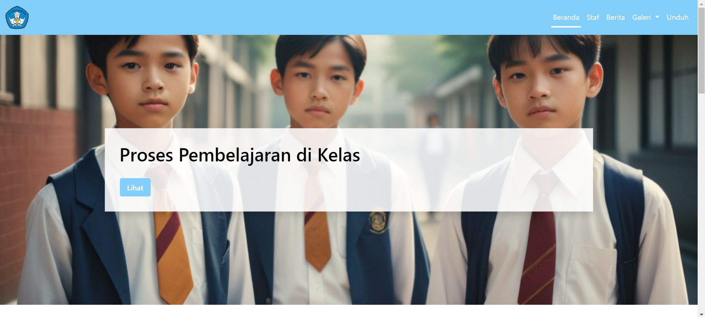
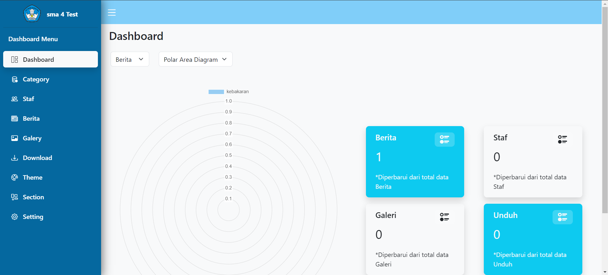

# Web Sekolah

Website ini dirancang untuk memudahkan pengguna dalam membuat website profil sekolah dengan fitur-fitur yang dapat disesuaikan, termasuk halaman utama profil sekolah, beranda, berita, staff, galeri foto dan video, serta unduh. Dilengkapi dengan panel admin yang user-friendly, platform ini memudahkan pengelolaan konten oleh pihak sekolah

## Landing Page



## Page User



## Page Dashboard Admin



## Run Locally

Clone the project

```bash
  git clone https://github.com/vetencode/website-sekolah.git
```

Go to the project directory

```bash
  cd website-sekolah
```

Install dependencies

```bash
  composer install
```

```bash
  npm install
```

```bash
  npm run build
```

```bash
 cp .env.example .env
```

```bash
Setup Database open .env

  DB_CONNECTION=mysql
  DB_HOST=127.0.0.1
  DB_PORT=3306
  DB_DATABASE=laravel
  DB_USERNAME=root
  DB_PASSWORD=
```

```bash
  php artisan migrate --seed
```

```bash
  php artisan key:generate
```

```bash
  php artisan storage:link
```

Start the server

```bash
  php artisan serve
```
Akun Admin

```bash
  email:admin@gmail.com
  password:12345678
```

## Demo

http://127.0.0.1:8000


<!-- Security scan triggered at 2025-09-02 02:38:01 -->

<!-- Security scan triggered at 2025-09-09 05:35:17 -->

<!-- Security scan triggered at 2025-09-28 15:38:22 -->